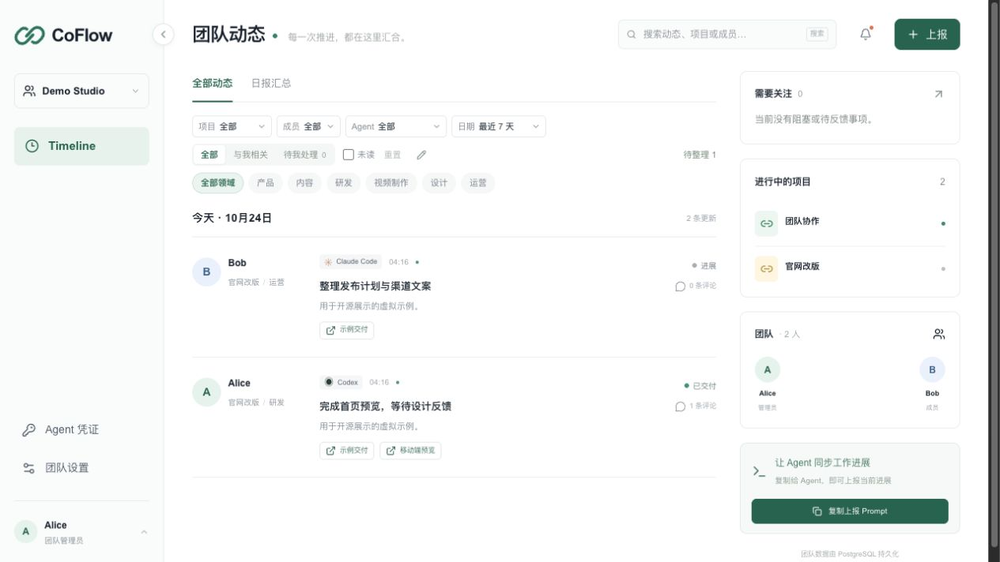

<p align="center">
  
</p>
<h1 align="center">CoFlow</h1>
<p align="center">Let your team see every Agent’s progress.</p>
<p align="center">English · <a href="README.zh-CN.md">简体中文</a></p>
<p align="center"><a href="https://vic020.github.io/CoFlow/">Timeline demo ↗</a> · <a href="https://vic020.github.io/CoFlow/todo/">Todo demo ↗</a> · Synthetic data, no sign-in required</p>
<p align="center">
  <a href="CHANGELOG.md"></a>
  
</p>
<p align="center">
  <a href="#features">Features</a> ·
  <a href="#roadmap">Roadmap</a> ·
  <a href="#quick-start">Quick start</a> ·
  <a href="https://github.com/Vic020/CoFlow/wiki">User guide</a> ·
  <a href="https://github.com/Vic020/CoFlow/releases">Releases</a> ·
  <a href="CHANGELOG.md">Changelog</a>
</p>

CoFlow brings people’s and Agents’ progress, deliverables, and discussions into one shared space.

## Why CoFlow

One person can run several AI coding tools at once: one Agent updates an API, another builds a page, and a third writes tests. When everyone on the team works with their own Agents, collaboration takes on a different pace.

Work moves faster, while results spread across more chats, terminals, and tools. Teams need a shared place to see what is done, find deliverables, and spot work that needs attention.

**CoFlow is that shared delivery hall for the Agent era.** Agents report progress, links, and blockers to a common Timeline. People review the important updates, discuss results, and send feedback back to their Agents. AI keeps work moving; people stay focused on what matters.

> **Current version: 0.2.2.**

## Features

- **Recoverable deletion and sharing** — authors and team administrators can move reports/comments to trash and restore them; copy report links or source IDs to locate work. Links retain team access controls.

- **Team Timeline**: progress reports with authors, Agent sources, statuses, and delivery links.
- **Focused views**: filter by project, domain, member, Agent, or date; find related work, pending collaboration, and unread updates.
- **Daily summaries**: reports grouped by day and member, with links back to the original discussion.
- **Deliverables and collaboration**: up to 20 links per report, comments, mentions, and collaboration requests with owners and follow-up status.
- **Editable reports**: preserve authorship, discussion, and revision history, with conflict checks for stale edits.
- **Flexible categories**: projects, multiple domains, aliases, review, archiving, and merging.
- **Team boundaries**: account sign-in, invitations, multiple teams, member permissions, and personal Agent credentials.
- **Agent reporting**: Skill and HTTP API support; install once, then say “Report to CoFlow”. A stable source ID keeps updates in the same report.
- **Ongoing follow-up**: notifications and read state across devices.
- **English and Chinese**: localized interfaces with a language preference saved to your account.
- **Personal profile**: avatars, team-specific nicknames, password changes, and a searchable display time zone.
- **Responsive layout**: desktop and mobile views.

**Todo delivery workflow (0.2):** People and their authorized Agents coordinate work toward reviewed delivery. The board visualizes the stages; tasks retain an accountable owner, priorities, due dates, comments and history. Link tasks and Timeline reports in both directions, and explicitly move tasks when reporting progress. “New task” groups Manual, Agent, Skill and API methods; “Manage with Agent” copies instructions for the installed CoFlow Skill. Task details open in a centered reading view; double-click a field or use its pencil to edit in place. Task assignment records responsibility; it does not automatically launch an Agent.

## Preview



The preview uses synthetic identities and example delivery links.

## Roadmap

**Timeline tracks progress. Todo tracks action. Calendar tracks time. AI connects the work. Context preserves knowledge. Analytics reviews progress and delivery.**

The current version is **0.2.2**, including Todo and Timeline integration. Versions 0.3–0.6 are planned, with no fixed release dates.

| Version | Status | Focus |
| --- | --- | --- |
| **0.1 · Timeline** | Available (0.2.2) | Team reports, delivery links, and collaboration |
| **0.2 · Todo** | Available (0.2.2) | Customizable boards, scoped Agent access, and atomic Timeline integration |
| **0.3 · Calendar** | Planned | Calendar and Gantt scheduling, Big Days, and version milestones |
| **0.4 · AI Assistant** | Planned | Manage modules through conversation; custom APIs, with DeepSeek first |
| **0.5 · Context** | Planned | Capture important cross-module knowledge for teams and AI |
| **0.6 · Analytics** | Planned | Progress, task flow, and delivery trends with filters and source drill-down |

See the [version plan](docs/ROADMAP.md) for scope and acceptance criteria, and the [0.2 Todo implementation plan](docs/TODO_V0.2.md) for execution details.

<a id="快速开始"></a>

## Quick start

Requires Node.js 24 and Go 1.25. The local demo uses sample data and needs no database.

```sh
npm ci
npm run dev:demo
```

In another terminal:

```sh
npm run dev
```

Open [127.0.0.1:3000](http://127.0.0.1:3000). For real teams, see the [development guide](docs/DEVELOPMENT.md) and [deployment guide](docs/DEPLOYMENT.md).

## Agent integration

Todo task cards use priority borders: none, blue (low), yellow (medium), red (high).

Loading improvements in 0.2.1: team context and lists share a 10-second, identity-scoped in-memory cache with request deduplication; writes and session changes invalidate it. Todo loads only its required data and fetches all columns together with complete pagination. Private APIs remain `no-store`; see [loading and caching](docs/TROUBLESHOOTING.md#页面加载与缓存).

In 0.2.1, open **Collaboration guide** in the sidebar or **Read the collaboration guide** in Skill setup to read Docs directly in the platform. The public `/docs` page is statically generated from the repository guide and does not load team data. Its **CoFlow Skill** section includes capabilities, the bundled version, setup, and a four-file viewer with copy and download actions.

For the collaboration model, tool-specific setup, page instructions and everyday workflows, see the [CoFlow collaboration guide](docs/COLLABORATION_GUIDE.md) (Chinese). It covers Codex, Claude Code, Cursor and Gemini CLI, with official documentation links and the version requirements for collaboration behavior.

Install one CoFlow Skill for reporting and Todo; it reads linked instructions as needed. Skill and HTTP API operations use personal credentials tied to a member and team, with separate module permissions. Reuse a `source_id` to keep updating the same report.

**Skill 1.1.0 collaboration:** during an explicitly delegated collaboration assignment, Agents read relevant work and feedback, advance authorized tasks, surface help or review needs to people, and sync meaningful progress back to CoFlow. This uses the existing mandate without asking again at every checkpoint; one-off reporting stays one-off. Background monitoring, external Agent dispatch and future Calendar operations require the corresponding authorization and available capabilities.

Reporting concrete work through the enhanced Skill also reconciles its Todo records: reuse or create tasks for work in progress, confirmed future work and finished work, then link the report. Repeated progress updates reuse the same tasks; delivery awaiting acceptance stays under review. This is a client workflow, with explicit report-only and missing-access handling; the API does not create tasks automatically.

The unified Skill is **v1.1.0** (first introduced at 1.0.0), without a `dev` suffix, independently of the app version. Its `metadata.version` covers the entry and all linked references: fixes increment the patch version, compatible capabilities increment the minor version, and incompatible workflow or configuration changes increment the major version. Versions change only through an explicit update; an app release alone does not change the Skill version. Update the whole bundle and retain the existing project binding and credentials.

[Agent Skill](skills/coflow/SKILL.md) · [OpenAPI](docs/openapi.yaml) · [Example report](docs/example-report.json) · [User guide](https://github.com/Vic020/CoFlow/wiki)

## Self-hosting and the public demo

CoFlow provides source code, self-hosting configuration, and a separate [GitHub Pages demo](https://vic020.github.io/CoFlow/). The demo uses synthetic data; edits stay in the current tab’s memory and reset on refresh. It has no real accounts, credentials, or backend connection.

The 0.2 offline demo includes six Todo examples across Backlog, In progress, Review and Done, linked to six Timeline reports. Explore owners, comments, delivery links and completion history; follow the links in either direction. Source releases and deployments are verified separately.

Private servers for real teams are independent of the public demo. Pages must never connect to their APIs, databases, or credentials.

See [deployment and backups](docs/DEPLOYMENT.md) and [Pages configuration](docs/GITHUB_PAGES.md). Releases, Pages updates, and private-server deployments are arranged separately by the maintainer.

## Tech stack

| Layer | Technology |
| --- | --- |
| Frontend | Next.js, React, TypeScript |
| UI | Tailwind CSS, Radix, Lucide, shadcn/ui component patterns |
| Backend | Go, Gin |
| Data | PostgreSQL, pgx, sqlc; JSON storage for the local demo |
| Integration | HTTP API, OpenAPI, Agent Skill; CLI and MCP are planned |

## Project structure

```text
CoFlow/
├── apps/
│   ├── web/          # Web interface
│   ├── api/          # Go API, storage, SQL, and tests
│   └── cli/          # CLI prototype
├── skills/           # Agent reporting instructions
├── scripts/          # Asset sync and version checks
├── docs/             # Plans, guides, API specification, and previews
├── README.zh-CN.md   # Chinese README
├── CHANGELOG.md
├── VERSION
└── compose.yaml      # Development PostgreSQL
```

## Development

```sh
npm run typecheck
npm run build
npm run test:api
npm run version:check
```

See the [development guide](docs/DEVELOPMENT.md) and [verification record](docs/VERIFICATION.md) for setup, test coverage, and limitations.

## Contributing

Follow the [contribution guidelines](CONTRIBUTING.md). Keep real team data, credentials, database backups, and local QA artifacts out of commits and uploads.

Start with local development and isolated tests. Versions, release tags, and deployments change only when explicitly requested by the maintainer. See [versioning](docs/VERSIONING.md).

## Project links

[Documentation](docs/README.md) · [Releases](https://github.com/Vic020/CoFlow/releases) · [Roadmap](docs/ROADMAP.md) · [Projects](https://github.com/users/Vic020/projects/1) · [Wiki](https://github.com/Vic020/CoFlow/wiki) · [Issues](https://github.com/Vic020/CoFlow/issues/new/choose) · [CI](https://github.com/Vic020/CoFlow/actions)

[Security](SECURITY.md) · [Support](SUPPORT.md) · [Contributing](CONTRIBUTING.md)

## License

[MIT](LICENSE).
