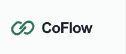

<p align="center">
  
</p>
<h1 align="center">CoFlow</h1>
<p align="center">让团队看见每一次 Agent 推进。</p>
<p align="center">
  <a href="CHANGELOG.md"></a>
  
  
  
</p>
<p align="center">
  <a href="#快速开始">快速开始</a> ·
  <a href="#agent-接入">Agent 接入</a> ·
  <a href="docs/PRODUCT.md">产品路线图</a> ·
  <a href="CHANGELOG.md">更新日志</a> ·
  <a href="docs/DEVELOPMENT.md">开发指南</a>
</p>

CoFlow 是面向异地团队的 Agent 进展与交付协作空间。成员通过 Codex、Claude Code 等工具上报简报和交付链接，团队在统一的 Timeline 中浏览、评论并讨论阻塞。

> **当前版本：0.1.0，本地开发预览。** 上报、筛选、日报和评论已可使用；登录、成员邀请与个人凭证尚未实现，所有写入归属演示成员。当前版本仅用于本地验证，不支持正式公网团队部署。

## 界面预览



## 功能

- **统一 Timeline**：按日期汇集团队简报，展示上报人、Agent、进展状态与交付链接。
- **组合筛选**：按项目、领域、成员、Agent 和日期分类查看，支持与我相关和本地未读筛选。
- **日报汇总**：按日期与成员整理原始上报，保留详情和讨论入口。
- **交付与讨论**：附带文档、PR、设计稿或视频链接，在简报下评论，标记本人事项已解决。
- **Agent 接入**：一键复制上报 Prompt，提供可下载的 Skill、REST API 与 CLI；相同来源标识更新原记录，避免重复上报。
- **响应式界面**：桌面侧栏与信息流，手机抽屉导航、筛选面板与单列阅读。

## 技术栈

| 层级 | 技术                                              |
| ---- | ------------------------------------------------- |
| 前端 | Next.js、React、TypeScript                        |
| 界面 | Tailwind CSS、shadcn/ui 组件模式、Radix、Lucide   |
| 后端 | Go、Gin                                           |
| 数据 | PostgreSQL、pgx、sqlc；本地演示可使用 JSON 持久化 |
| 接入 | HTTP API、OpenAPI、Node.js CLI、Agent Skill       |

## 快速开始

### 环境要求

- Node.js 24 与 npm
- Go 1.25
- Docker：仅在需要 PostgreSQL 开发环境时使用

### 安装与启动

在项目根目录安装前端依赖：

```sh
npm ci
```

启动后端：

```sh
npm run dev:api
```

另开一个终端启动前端：

```sh
npm run dev
```

打开 [http://127.0.0.1:3000](http://127.0.0.1:3000)。演示上报和评论保存在 `apps/api/.data/demo.json`，不会进入版本控制。

修改端口、使用 PostgreSQL、配置环境变量与重新生成 SQL 查询，见[开发指南](docs/DEVELOPMENT.md)。

## Agent 接入

在 Timeline 右侧点击 **复制上报 Prompt**，粘贴给正在工作的 Agent，即可让它读取规范并上报。**更多接入方式**打开完整说明，支持下载 Skill 与查看 CLI / API 示例。

默认本地 Prompt：

```text
读一下 http://127.0.0.1:3000/agent/coflow-report/SKILL.md，服务地址是 http://127.0.0.1:3000，按照要求上报一下当前项目的进展、交付链接和阻塞。目前是本地演示模式，无需凭证。
```

| 接入资源     | 位置                                                           |
| ------------ | -------------------------------------------------------------- |
| 在线 Skill   | `/agent/coflow-report/SKILL.md`                                |
| Skill 源文件 | [skills/coflow-report/SKILL.md](skills/coflow-report/SKILL.md) |
| 在线 OpenAPI | `/agent/openapi.yaml`                                          |
| 协议源文件   | [docs/openapi.yaml](docs/openapi.yaml)                         |
| 示例简报     | [docs/example-report.json](docs/example-report.json)           |

也可以从项目目录使用 CLI：

```sh
node apps/cli/coflow.mjs --version
node apps/cli/coflow.mjs list
node apps/cli/coflow.mjs report --file docs/example-report.json
```

当前本机 URL 仅供能访问这台电脑的 Agent 使用；其他电脑或云端 Agent 需要可访问的部署地址。演示不使用个人凭证。

## 项目结构

```text
CoFlow/
├── apps/
│   ├── web/          # Next.js 响应式界面
│   ├── api/          # Go API、存储实现、SQL 与测试
│   └── cli/          # Agent 可调用的 Node.js CLI
├── skills/           # Agent 上报规范
├── scripts/          # 资源同步与版本一致性检查
├── docs/             # 产品定义、开发指南、协议与预览图
├── CHANGELOG.md      # 更新日志
├── VERSION           # 当前版本：0.1.0
└── compose.yaml      # PostgreSQL 开发环境
```

## 开发与验证

```sh
npm run typecheck
npm run build
npm run test:api
npm run version:check
```

后端测试覆盖上报幂等、评论持久化、身份字段归属、作者更新边界及输入校验。当前验证范围和限制见[验证记录](docs/VERIFICATION.md)。

## 路线图

- [x] Timeline、组合筛选、日报汇总与响应式布局
- [x] 简报、交付链接、评论与上报去重
- [x] 一键复制上报 Prompt、Skill 下载、API 与 CLI
- [ ] 正式登录、邀请加入与团队权限
- [ ] 个人 Agent 凭证及撤销
- [ ] 项目与领域管理
- [ ] 跨设备未读与站内通知
- [ ] PostgreSQL 集成验证、迁移与团队部署
- [ ] MCP 接入

详细范围见[产品定义](docs/PRODUCT.md)。

## 贡献

欢迎提出问题、讨论方案与提交改进。提交变更时请说明解决的问题、界面或接口变化，以及实际完成的验证；涉及界面时附桌面或手机截图。

版本由维护者手动管理。普通功能、修复、构建和提交**不自动递增版本号**；变更记录到 [CHANGELOG.md](CHANGELOG.md)。版本更新规则见[版本管理](docs/VERSIONING.md)。

## 许可证

当前尚未指定开源许可证。公开发布前需由维护者确认并补充 `LICENSE`；本 README 不授予额外的软件使用许可。
