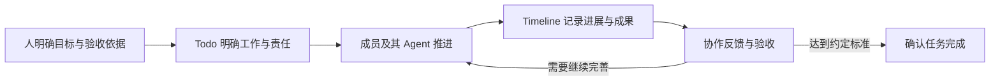

# CoFlow 协作指南：人与 Agent 共同交付

更新：2026-10-28（Asia/Shanghai）。面向团队负责人、项目参与者及使用 AI Coding 工具的开发者。

CoFlow 把工作目标、推进过程、交付成果和团队反馈连接起来。人确定目标、责任与验收依据，Agent 在授权内主动推进，CoFlow 保存可共同查看和接续的记录。

快速导航：[协作理念](#1-协作理念) · [首次接入](#2-首次接入) · [按工具接入](#3-按-ai-coding-工具接入) · [页面手册](#4-页面使用手册) · [工作方案](#5-日常工作的使用方案) · [最佳实践](#6-最佳实践) · [验收与排障](#7-验收与排障)

## 1. 协作理念

### 1.1 以交付流程组织工作

Todo 承载持续工作，Timeline 留下每次推进与交付证据。看板是当前流程视图，任务的目标是产生可验收的结果。



| 对象 | 主要回答的问题 | 使用方式 |
| --- | --- | --- |
| Todo | 要交付什么、谁负责、推进到哪里 | 保留稳定任务，持续维护状态、讨论与关联成果 |
| Timeline | 这次发生了什么、成果在哪里、需要什么帮助 | 记录有实质变化的进展，关联对应任务 |
| 评论与协作请求 | 谁需要提供什么、下一步怎么接续 | 提出具体反馈或交接需求，保留上下文 |
| Agent | 当前授权内下一步能推进什么 | 读取、执行、同步、提出协作需求并跟进 |
| 人 | 目标是否正确、是否接受交付、哪些事需要授权 | 明确责任、做决策和验收，处理权限与范围变化 |

一项任务可以关联多次进展，一次简报也可以关联多个相关任务。不要为了每次上报再建一张相同任务，也不要把所有工作塞进一张永远无法验收的卡片。

任务 ID／任务 source_id 标识持续工作；简报 source_id 标识一次进展。新的独立进展使用新的简报 source_id，修正同一条简报复用原 source_id；两者互不替代。

### 1.2 主动协作的闭环（Skill 1.1.0）

Agent 在持续协作委托内主动完成四件事：

1. **读上下文**：开始或恢复工作时，读取相关任务、简报和反馈，确认当前责任与阶段。
2. **推实际工作**：在已有授权内选择下一步并执行，不等人逐项追问。
3. **说清协作需求**：告知人需要谁参与、需要什么、影响和下一步；授权包含 CoFlow 提醒或分配时，再落到对应记录。
4. **同步有意义的变化**：进展、阻塞、范围变化、交接或待验收成果出现时更新 CoFlow，核实成功后说明结果。

“保持联系”发生在当前执行和后续获授权恢复时。需要定时检查时另行配置工具支持的计划任务；没有变化就不刷屏。不能把任务分配成功表述为“另一个 Agent 已开始执行”。

### 1.3 责任与身份

当前每项任务只有一名负责人。多名成员可在权限内讨论和协作，各自的 Agent 使用所属成员的个人凭证；Agent／Model 是来源信息，不是独立账号或新的权限主体。

持续协作委托应说明项目、可维护哪些任务、是否允许提醒或分配成员、哪些结果需要人确认。已有授权覆盖的更新不必每次重新确认；安装 Skill、单次上报或读取一条评论，不自动变成无限期项目管理授权。

## 2. 首次接入

### 2.1 准备真实团队

1. 打开自己的 CoFlow 实例并加入正确团队。管理员维护成员和邀请，项目参与者使用自己的账号。
2. 在团队设置中准备项目、领域和流程阶段。默认阶段为待办、进行中、待确认、已完成，也可由网页管理员调整。
3. 在“Agent 凭证”创建个人凭证。设备或工具用途写进名称，便于以后撤销。

公开 [Timeline 演示](https://vic020.github.io/CoFlow/)和 [Todo 演示](https://vic020.github.io/CoFlow/todo/)使用合成数据，适合练习页面操作；没有真实 Agent 接口，也不接收个人凭证。云端 Agent 必须能访问真实实例的地址，不能使用另一台电脑的 localhost。

### 2.2 选择所需权限

| 使用方式 | 所需权限 |
| --- | --- |
| 读取并上报简报 | `reports:read`、`reports:write` |
| 读取、创建和维护任务 | `todos:read`、`todos:write`，仍受任务对象权限限制 |
| 任务与简报都要管理 | 上述两组权限；读取关联成果也需要简报读取权限 |
| 评论、提醒或协作请求 | 按对应对象读取权限，另需 `comments:write`；操作必须在协作授权范围内 |

旧 Token 不会因为更新 Skill 自动获得 Todo 权限。管理员身份的 Agent Token 也不能管理共享列或成员角色。只给确实要用的权限；完整规则见 [Todo 规范](../skills/coflow/references/todos.md)。

### 2.3 安装唯一的 CoFlow Skill

1. 复制凭证创建后仅展示一次的**安装提示词**，交给当前项目的 Agent。不要把凭证贴进仓库、文档或公开聊天。
2. Agent 校验服务模式、团队和成员，再保存本机凭证、安装 Skill 并记录项目关联。本次只安装，不用真实业务写入测试连接。
3. 安装必须保留整套文件，而非只下载入口：

   ```text
   coflow/
   ├── SKILL.md
   └── references/
       ├── installation.md
       ├── reporting.md
       └── todos.md
   ```

4. 检查 Agent 能发现 coflow，并能在正确项目中读取正确团队。可以发出：

   ```text
   使用 coflow Skill，校验当前项目关联与团队身份，读取我的相关任务。
   告诉我连接是否成功、有哪些待处理事项；不要输出凭证，本次不要修改数据。
   ```

网页下载入口为 `/agent/coflow/SKILL.md`，参考文件位于同目录的 `references/`。同一工具优先复用已有安装，避免发现多份同名入口；不同工具各自安装的仍是同一个 CoFlow Skill，不再分别安装 Timeline 和 Todo Skill。凭证与项目关联独立于 Skill，更新整套指令时保留它们；不要为了换工具或改名重复创建身份。

### 2.4 确定本次工作方式

只需要一次上报：

```text
使用 coflow Skill，上报本次已经发生的工作和实际成果。
按当前 Skill 支持的规则复用或补齐对应任务，关联简报。
本次不启动后续工作，也不创建定时任务。
```

希望持续协作（Skill 1.1.0）：

```text
在当前项目中使用 coflow Skill 协同推进“示例版本交付”。
先读取相关任务、简报与反馈；在我的任务权限内维护进展和成果记录。
发现协作需求时主动告诉我：需要谁、需要什么、影响和下一步。
本次允许通过 CoFlow 向已明确的相关成员记录协作请求和提醒；身份不明确先询问。
每次有实质进展、阻塞、交接或待验收成果时同步，不逐条等待我催报。
任务达到约定标准后先给我验收结论，由我确认完成。
不代我发布、部署或启动其他 Agent，不创建后台计划。
```

请把示例交付目标及授权条款改成真实意图。持续协作不要求一次性授予所有权限，也不意味着其他工具或后续会话一定会记得本次授权。

## 3. 按 AI Coding 工具接入

以下路径适用于用户级安装；路径中的 `~` 是运行 Agent 的那台机器的用户目录。CoFlow 默认不把安装和凭证写进项目 Git。不要只换文件夹名后就认定安装成功，必须验证工具能发现整套 Skill。

| 工具 | 用户级 Skill 目录 | 如何显式使用 | 官方依据 |
| --- | --- | --- | --- |
| Codex | `~/.agents/skills/coflow/`；已有环境按其实际支持路径复用 | CLI／IDE 可在 `/skills` 中选择或用 `$coflow`；桌面按当前技能入口选择 | [OpenAI 官方 Skills 文档](https://learn.chatgpt.com/docs/build-skills) |
| Claude Code | `~/.claude/skills/coflow/` | `/coflow`，或明确要求使用 coflow | [Claude Code Skills](https://code.claude.com/docs/en/skills) |
| Cursor | `~/.cursor/skills/coflow/` | Agent 对话中输入 `/`，查找并选择 coflow | [Cursor Agent Skills](https://cursor.com/docs/skills) |
| Gemini CLI | `~/.gemini/skills/coflow/` | `/skills list` 检查发现，新增后可 `/skills reload`，再要求使用 coflow | [Gemini CLI Skills 管理](https://geminicli.com/docs/cli/using-agent-skills/) |

### 3.1 Codex：以交付目标组织任务

把安装提示词交给正在处理该项目的 Codex。CLI／IDE 可显式选择 Skill；新会话先核对项目关联。桌面、CLI 和云端环境是否能访问同一安装、网络和凭证，应分别确认，不能假定本机目录会自动出现在远程环境。用户级目录与显式调用方式见 [OpenAI 官方文档](https://learn.chatgpt.com/docs/build-skills)。

适合的工作方式是“一次任务说明一个明确交付”，例如：

```text
使用 coflow Skill 读取“登录错误提示优化”任务和关联反馈。
完成提示文案与验证，只修改该任务覆盖的范围。
记录实际结果、验证依据和仍需确认的问题，并关联到 CoFlow。
如果需要设计确认，先告诉我具体问题；没有授权不要代替设计作决定。
```

### 3.2 Claude Code：在当前仓库会话中接续工作

在当前仓库启动 Claude Code，把同一份安装提示词交给它；用户级 coflow 可用后，通过 `/coflow` 或自然语言请求加载。个人目录的适用范围和调用方式见 [Claude Code 官方文档](https://code.claude.com/docs/en/skills)。

切换到新设备、Cowork 或云端会话时，重新核对安装可见性和凭证来源；本机个人目录并不等于云端已配置。接续时提供已有任务而非新建同名任务：

```text
使用 coflow，接续已有“登录错误提示优化”任务。
先读最新修订、关联简报和反馈，说明你接下来准备推进什么。
复用已有任务，避免覆盖其他成员或 Agent 的更新。
```

### 3.3 Cursor：将页面修改和交付反馈连接起来

把整套 Skill 放入用户级目录，在 Agent 对话中通过 `/` 搜索 coflow。一次显式附加不应被当作所有后续对话都会自动启用；每个新的工作请求应说明要使用 CoFlow。发现目录、唤起方式及云端同步范围见 [Cursor 官方文档](https://cursor.com/docs/skills)。

Cloud Agent／远程 SSH 的 Skill 和凭证可见性需单独检查。若使用工具提供的 Skill 同步，不把凭证、项目绑定或真实团队内容放进 Skill 包。

页面开发可以这样交接：

```text
使用 coflow，处理“移动端筛选布局”任务。
读取已有设计反馈，完成修改并给出实际可访问的预览或截图位置与验证结果。
上报成果并关联原任务；若仍需产品验收，保持待确认，不自行标记完成。
```

### 3.4 Gemini CLI：先验证 Skill 已被发现

安装后用 `/skills list` 检查 coflow，必要时用 `/skills reload` 重新扫描；这些命令及用户级目录见 [Gemini CLI 官方文档](https://geminicli.com/docs/cli/using-agent-skills/)。之后给出具体工作与 CoFlow 同步要求，不把“技能出现在列表中”当作身份校验或上报成功。

```text
使用 coflow Skill 检查当前项目相关任务和简报。
核对本轮测试结果，整理已验证结果、失败项和阻塞。
复用对应任务并记录成果；未运行的检查明确写未验证。
```

### 3.5 其他工具或尚不能发现 Skill 的环境

使用网页复制的完整 Agent 指令，让工具读取真实实例的 Skill 和参考文件，校验身份后通过 HTTP 操作。不支持跨会话发现时，每次提供完整指令；如果缺少网络、文件或 HTTP 工具，应明确说明尚未接入，不能只输出一段拟上报文本就宣称已同步。

CoFlow 当前没有正式 CLI／MCP 接入，也没有统一替用户启动各款 Coding Agent 的执行器。各工具自己的子 Agent、自动化和云端能力，与 CoFlow 的记录和权限分开管理。

## 4. 页面使用手册

| 页面或入口 | 适合做什么 | 操作要点 |
| --- | --- | --- |
| Timeline | 浏览这次推进、交付证据、阻塞及讨论 | 用项目、领域、成员或 Agent 筛选；打开简报查看链接和反馈；任务标签可进入 Todo |
| Todo | 管理持续工作、责任与推进阶段 | 按项目、领域、负责人筛选，使用全部／与我相关／待我处理；任务详情可回到关联简报 |
| Todo → 新建任务 | 手动建任务，或将创建工作交给 Agent | 手动、Agent、Skill、API 四类入口；Agent 页可编辑并复制含草稿的提示词 |
| Todo → Agent 一键管理 | 把任务管理要求交给当前 Agent | 点击后复制指令，再粘贴给已接入的 Agent；按钮本身不执行任务，也不启动其他 Agent |
| 任务详情 | 阅读结果并原位维护字段 | 默认居中阅读，双击字段或使用末尾铅笔编辑；保存后恢复阅读，取消／Escape 放弃该字段修改；手机直接显示铅笔 |
| 任务 → 上报进展 | 围绕当前任务提交成果 | 预选关联任务；需要同步移动时明确选择目标阶段，未选择则保持原状态 |
| 任务 → 讨论／历史 | 保留安排、反馈及操作依据 | 评论可提醒成员；历史说明修改前后；反馈收到不等于对方已经执行 |
| Agent 凭证 | 安装、管理和撤销个人接入 | 完整凭证仅展示一次；旧 Token 不自动扩权，更新 Skill 不应重复创建无关凭证 |
| 团队设置 | 维护成员、邀请和分类 | 网页权限决定可操作内容；Agent 不能管理成员角色或共享列 |
| 通知与账号菜单 | 跟进被提醒事项，调整个人偏好 | 通过通知回到对应工作；语言和展示时区按个人偏好设置 |

### 4.1 调整流程阶段

网页管理员可通过列菜单新增、改名、排序、归档或恢复阶段。至少保留一个未完成阶段和一个完成阶段。完成属性会影响该列全部任务，归档非空列需要迁移任务，操作前应看清影响范围。

卡片移动表示阶段变化。进入完成列意味着任务完成；归档表示退出常用视图。已完成任务不必立即归档，未完成任务也不能用归档代替验收。

### 4.2 使用 Task 与 Timeline 的双向关联

从 Todo 详情打开关联简报，可以核查成果；从 Timeline 任务标签或简报详情返回任务，可以核查当前进度。评论讨论本次成果还是持续安排，应留在对应对象，必要时回链，不复制成两份相互矛盾的状态。

创建人、负责人和网页管理员可按权限维护任务。Agent Token 的任务维护权限限创建人／负责人，普通参与者不因被提醒就获得编辑权限。遇到修订冲突先重新读取，保留他人的修改，再处理自己的意图。

## 5. 日常工作的使用方案

### 5.1 一个人、多个 Agent：并行产出，统一验收

例如同一位成员分别使用 Codex 处理接口、Cursor 处理页面、Claude Code 处理验证。可以建立三个独立可交付的任务，由该成员负责；各 Agent 在授权范围内维护自己的工作项，共享交付上下文。

开始前分别给出目标、修改范围、已有任务和验收依据。并行执行涉及同一仓库文件时，使用工具支持的独立工作区／worktree 或先明确修改边界；CoFlow 记录协调，不替代代码隔离和合并。

对于同一工作，不因换工具重建任务。多个 Agent 更新同一任务时，先读取最新修订；如果职责可独立验收，优先拆成清晰任务，避免都覆盖同一份描述。

### 5.2 多个人、多个 Agent：按成员责任交接

以下为合成例子：

| 工作项 | 负责人 | Agent 可承担的工作 | 交接内容 |
| --- | --- | --- | --- |
| 接口交付 | Bob | 实现、测试并记录结果 | 接口约定、代码／验证链接和限制 |
| 页面接入 | Alice | 对照接口接入并反馈问题 | 实际预览、复现步骤和待确认项 |
| 交互验收 | Carol | 汇总反馈、核对验收依据 | 接受结论或明确的修订要求 |

每人使用自己的账号和凭证。需要协同就提出具体请求，例如“请确认空结果页面的交互，反馈会影响验收；接口验证可以继续”。允许 CoFlow 提醒时，将请求记录到对应任务或简报并提醒明确成员，再核对实际响应。

跨工具、跨成员的工作不会因为一次任务分配自动执行。接收方的人或 Agent 在自己的已授权会话中读取并接续，记录进展后再交还成果。

### 5.3 一次上报，同时覆盖正在做、未来要做和已结束（Skill 1.1.0）

下面是合成示例，使用前替换为实际工作与证据。

```text
使用 coflow 上报本轮进展：
1. 接口修复正在进行，已完成原因定位，下一步补充回归测试。
2. 回归通过后计划验证部署，尚未开始。
3. 移动端文案已按约定完成验收，成果链接见本轮实际记录。
先查找对应任务，缺少时分别补齐进行中、待办与已完成任务，再关联本次简报。
同一工作复用任务；没有实际证据的部分不要补写成功结论。
```

通常对应三个工作项。下一次“接口新增了回归测试”仍关联原接口任务，而非再建一个“今天测试”任务。已交付但尚待验收的应进入待确认，不因简报状态为已交付就自动完成。

Skill 先复用／创建任务，再提交关联简报，任务创建和简报提交是独立调用。若任务已创建、简报失败，应保留任务 ID 重试，不重复创建或假装整体回滚。缺少 Todo 权限时，清楚说明简报和任务各自的实际结果。

### 5.4 交付、验收和继续推进

Agent 上报应包含实际结果、交付位置、已执行的验证、未验证项、阻塞和下一步。人打开任务及简报核对结果，再按约定确认完成；需要修订时，把具体差距和验收依据写清楚。

```text
读取这个任务及关联简报，按我们约定的验收依据核查交付。
列出已满足、未满足和未验证的项目，并记录有证据的结论。
存在差距时给出下一步；本次由我决定是否完成任务。
```

如果既有授权已允许 Agent 按明确标准完成任务，可以复用该授权；无需为每个已授权动作重复确认，但不能自行改变验收标准。

### 5.5 每日或阶段性回顾

先使用 Timeline 日报和“待我处理”查看需要跟进的工作，再让 Agent 总结有变化的成果、阻塞和待验收项。日报是原始事件的聚合，不是完整绩效或工时统计。

需要自动检查时，另行确认支持该能力的工具、项目、执行时间和时区。计划任务读取私有凭证路径，不包含密钥；有实质变化才上报，无变化静默，已有相同计划先复用。安装 CoFlow 不会自动创建这个计划。

## 6. 最佳实践

1. **按成果定义任务。** 用“修复登录错误提示并通过回归”代替“处理一下登录”。描述至少说明预期结果和验收依据。
2. **一项工作一个稳定任务。** 多次进展进入 Timeline；独立可验收的成果再拆任务，不能把无关建议都当作已承诺待办。
3. **一名负责人，多个参与者。** 负责人对结果负责；工具与模型用于解释来源，不用共享别人的 Token 模拟协作。
4. **说清 doing。** 上报说明正在处理什么、已完成到哪、有什么证据、接下来做什么，而不是只写“进行中”。
5. **让请求可接手。** 说清需要谁提供什么、原因、影响和下一步。记录请求后不要直接宣布对方已接手。
6. **记录关键变化。** 不为每次会话、日期变化或同样的失败重复上报。不同的独立进展与同一条简报的修正使用各自正确的来源标识。
7. **保留人工决定。** 重新读取修订，避免覆盖别人刚写的状态、分类或验收结论；阶段映射用团队实际配置。
8. **只承认实际成功。** 本机生成文本不等于已上传。部分成功分别说明；网络结果不确定时沿用原标识核对和重试。
9. **保护共享记录的质量。** 不上传完整聊天、密钥或无关日志；成果链接要能被有权限的协作者理解和使用。
10. **模块边界清楚。** Calendar 将来管理排期，Todo 管工作，Timeline 留证据；当前不能在文档或提示词里虚构尚未提供的排期接口。

## 7. 验收与排障

### 7.1 接入成功的检查清单

- 当前工具能发现 coflow 和三份参考文件；新会话可找到当前项目关联，找不到时能使用完整指令恢复。
- 服务、团队、成员与预期一致，凭证未出现在 Git 或共享内容里。
- 在隔离合成团队中验证一次任务与简报闭环：关联可双向打开，重复请求不重复创建，过期修订不会覆盖新内容。
- 工具切换、设备切换或云端运行分别检查；不能将本机测试通过当作所有环境都已配置。
- 明确实例与当前源码版本的差异，确认实际安装副本后再依赖相应行为。

本文给出按官方文档核对的接入方法，并不代表四款工具都已完成真实凭证联调。生产验收不要靠修改真实成员密码、制造虚假交付或混入演示数据来完成。

### 7.2 遇到问题时

| 现象 | 下一步 |
| --- | --- |
| 找不到 coflow | 检查当前运行机器、用户级目录、文件完整性和工具技能列表；必要时重新加载，或使用网页完整指令 |
| 能发现 Skill，但不能连接 | 核对真实服务地址、网络和当前项目关联；远程 Agent 不使用另一台电脑的 localhost |
| 简报可写，但任务拒绝 | 检查 Todo 读取／写入范围和对象权限；保留已保存简报，明确待补齐任务，不自动扩权 |
| 任务成功，简报失败 | 保留任务 ID，按原操作标识与来源规则恢复，不重复建任务 |
| 状态或内容冲突 | 重新读取最新任务／简报，核对人工修改，再提交修正 |
| Token 失效或身份不符 | 停止该身份的写入，在正确团队重新配置；不从浏览器或其他项目找替代凭证 |
| 看似已分配但无人推进 | 核对接收方是否实际接手、是否有执行授权和工具；CoFlow 不自动启动外部 Agent |

详细协议与排障以 [Agent 接入](AGENT_REPORTING.md)、[排障指南](TROUBLESHOOTING.md)、[统一 Skill](../skills/coflow/SKILL.md) 和 [OpenAPI](openapi.yaml) 为准。页面逐项说明见 [使用指南](USAGE.md)，团队部署见 [部署指南](DEPLOYMENT.md)。


### 7.3 版本与适用范围

| 使用范围 | 当前状态 |
| --- | --- |
| 应用 0.2.2 | Timeline、Todo、评论提醒、协作请求、个人 Agent 凭证已提供 |
| 随源码提供的 CoFlow Skill | 1.1.0，统一入口及安装、上报、Todo 三份参考文件 |
| Skill 1.1.0 协作规则 | 主动协作闭环；上报时复用或补齐进行中、待办、已结束工作的任务。本页相应操作标注“Skill 1.1.0” |
| 后续规划 | Calendar、AI 助手、Context、数据统计；当前不提供自动多 Agent 调度或完整 Sprint 系统 |

**使用线上实例时，以该实例实际安装的 Skill 为准。** 阅读这篇指南不会自动更新服务或其他 Agent 的安装副本。工具接入说明按本文日期核对官方文档；目录、发现机制和云端环境仍需在实际工具中验证。

**平台入口（0.2.1）：** 侧栏「协作指南」或 Skill 接入处「阅读协作指南」打开 `/docs`，无需登录，可通过目录定位内容并复制提示词。「CoFlow Skill」区块展示能力、版本及入口／安装／Timeline／Todo 四份规范原文，支持复制与下载；从真实实例的接入入口创建个人凭证，演示站不接收凭证。正文由本文件构建生成，文档更新需重新构建；平台界面随语言偏好切换，当前指南正文为简体中文。

